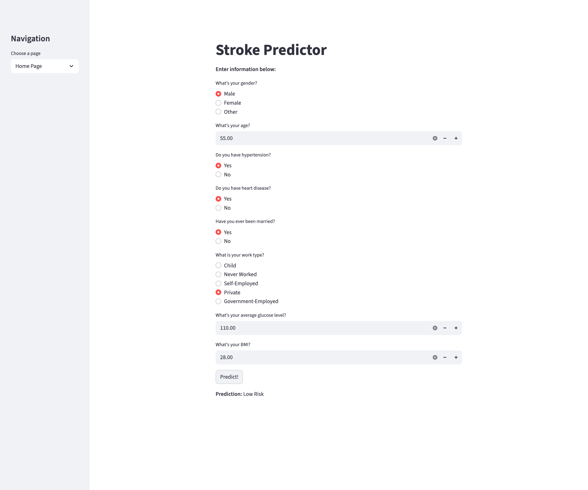
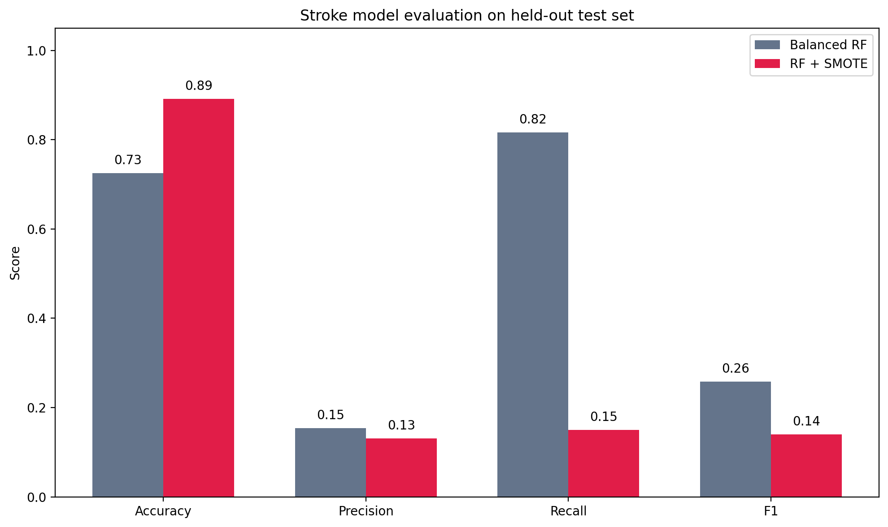
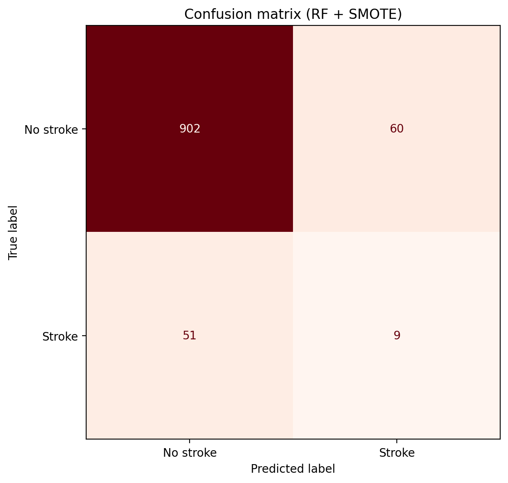
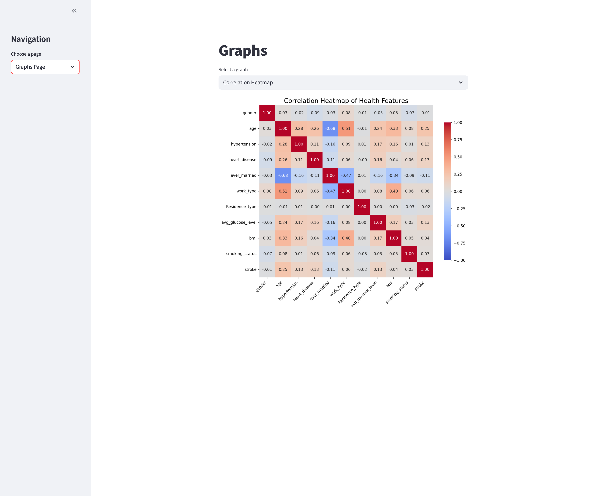
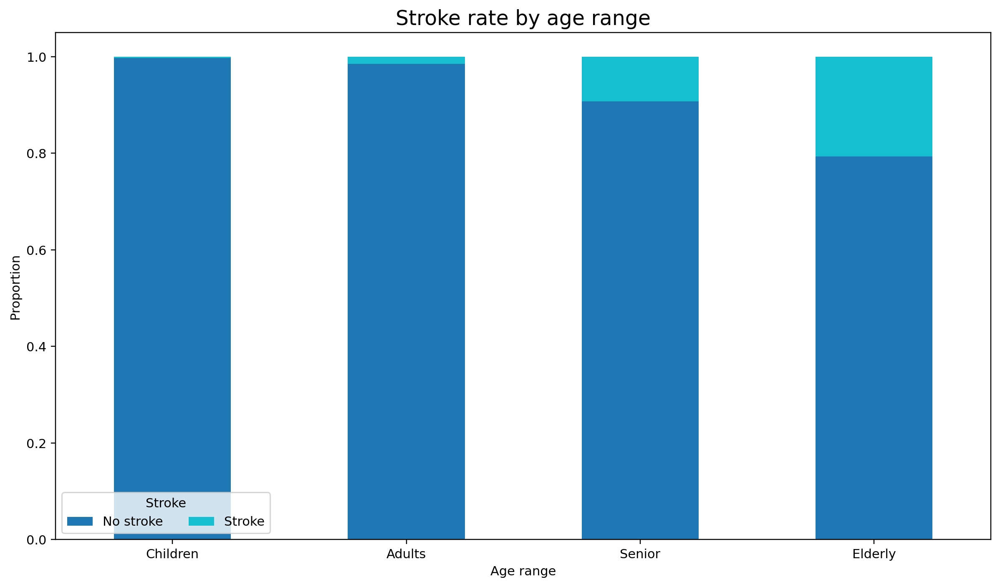

# Heart Stroke Risk Prediction

Machine learning project that predicts stroke risk from healthcare patient features. Built as a team project through the AI Student Collective (AISC) at UC Davis. Includes preprocessing, two class-imbalance-aware models, evaluation metrics, and a Streamlit app for interactive predictions and EDA plots.

## Dataset

Source file: `healthcare-dataset-stroke-data - healthcare-dataset-stroke-data.csv`

Features used after cleaning include gender, age, hypertension, heart disease, marital status, work type, average glucose level, BMI, and the binary stroke label. Intermediate and final tabular outputs are written to `processed.csv`.

## Pipeline

### 1. Preprocessing / feature engineering

`DataProcess.py`

- Drop the `id` column
- Impute missing BMI values with the column mean
- Encode categorical fields to integers:
  - `gender`: Male=0, Female=1, Other=2
  - `ever_married`: Yes=0, No=1
  - `work_type`: children=0, Never_worked=1, Self-employed=2, Private=3, Govt_job=4
  - `Residence_type`: Urban=0, Rural=1
  - `smoking_status`: never smoked=0, Unknown=1, formerly smoked=2, smokes=3

`ML_dataprocess.py`

- Drop `smoking_status` and `Residence_type` before modeling
- Rewrite `processed.csv` for training

Encoding reference notes also live in `healthcare-dataset-guide.mk`.

### 2. Train / test split

`ML.py` uses an 80/20 train-test split (`test_size=0.2`, `random_state=99`).

### 3. Models

Because stroke cases are rare, the training script compares two imbalance-aware approaches:

1. **Balanced Random Forest** (`BalancedRandomForestClassifier`, 100 estimators)
2. **Random Forest + SMOTE** (`SMOTE` on the training set, then `RandomForestClassifier` with `class_weight="balanced"`, 100 estimators)

The SMOTE Random Forest is pickled to `stroke_model.pkl` and loaded by the Streamlit app.

### 4. Evaluation

For each model, the script reports:

- Accuracy
- Precision
- Recall
- F1 score
- Confusion matrix
- Classification report

## Streamlit app

`app.py` provides:

- **Home Page:** form inputs for patient features and a High Risk / Low Risk prediction from `stroke_model.pkl`
- **Graphs Page:** correlation heatmap plus stacked proportion plots by gender, age range, smoking status, hypertension, heart disease, work type, and BMI range

Run locally:

```bash
python -m venv .venv
source .venv/bin/activate   # Windows: .venv\Scripts\activate
pip install pandas numpy scikit-learn imbalanced-learn streamlit seaborn matplotlib
python DataProcess.py
python ML_dataprocess.py
python ML.py
streamlit run app.py
```

## Screenshots

### Stroke Predictor



Interactive Streamlit form where visitors enter health features and get a risk prediction.

### Model metrics



Held-out accuracy, precision, recall, and F1 for Balanced RF vs RF + SMOTE.

### Confusion matrix



Test-set confusion matrix for the deployed RF + SMOTE model.

### Graphs page



Full Streamlit graphs view with the correlation heatmap selected.

### Age range chart



Stroke proportion across age groups from the healthcare dataset.

## Project layout

```
DataProcess.py       Initial cleaning and categorical encoding
ML_dataprocess.py    Feature drops before modeling
ML.py                Train/test split, models, metrics, pickle export
Dataplot.py          Additional plotting helpers
app.py               Streamlit UI
processed.csv        Cleaned modeling table
stroke_model.pkl     Serialized SMOTE Random Forest
```

## Team context

AISC quarter-long team project covering preprocessing, feature engineering, model development, evaluation, and a Streamlit prediction UI demo. Collaboration history is visible in the fork / PR history on GitHub.

## Repo hygiene note

`.venv/` and `__pycache__/` should not be committed. A `.gitignore` is included so local environments and bytecode stay out of version control. If those paths are still present in git history from earlier commits, remove them from the index when convenient:

```bash
git rm -r --cached .venv __pycache__
```
